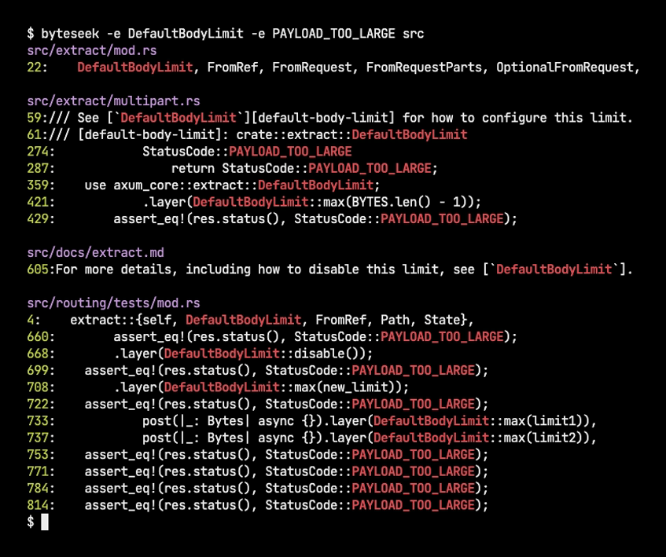
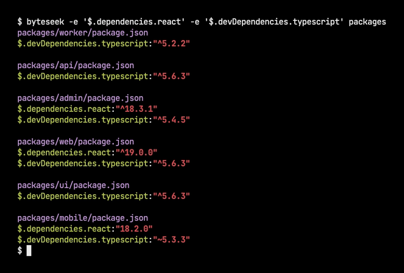
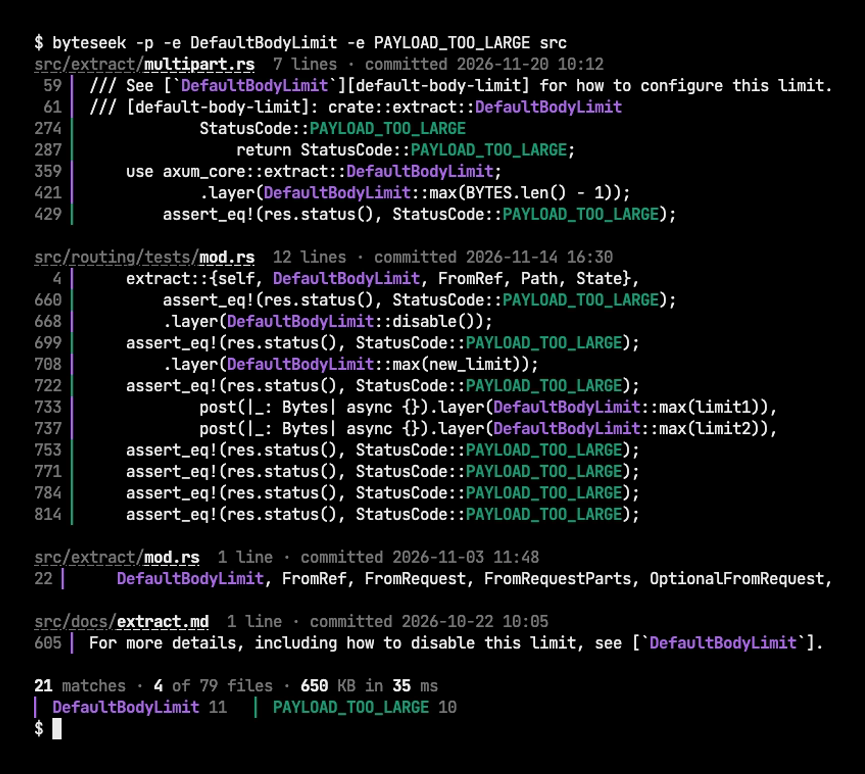
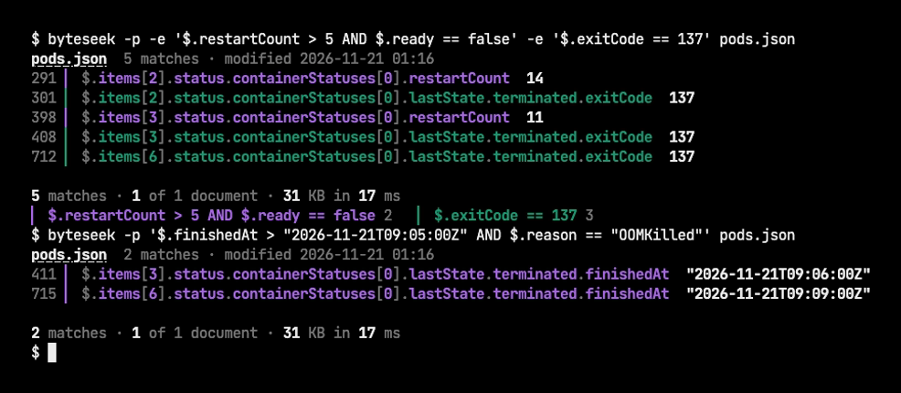
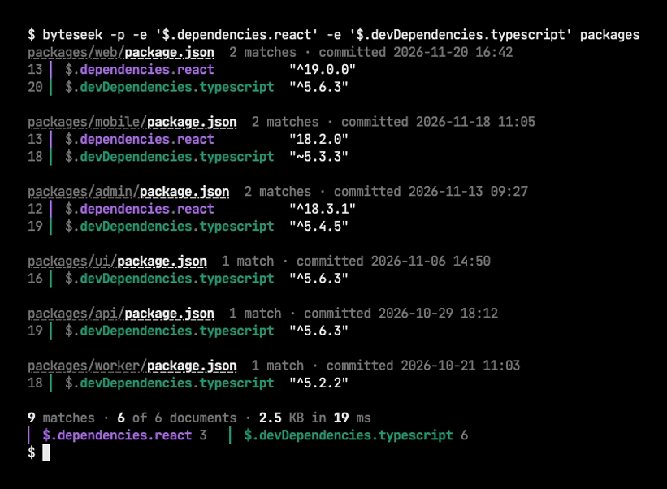
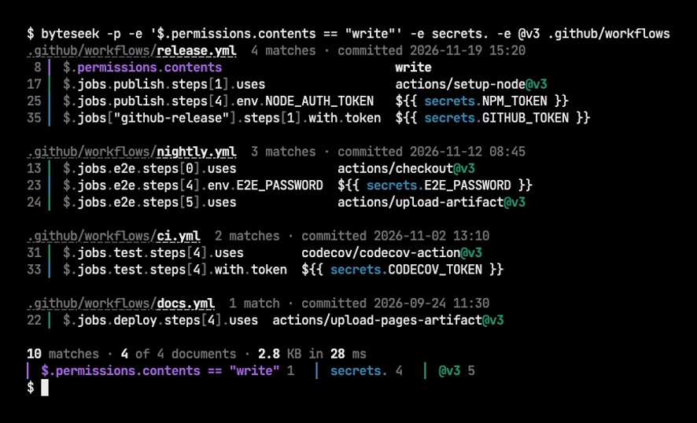
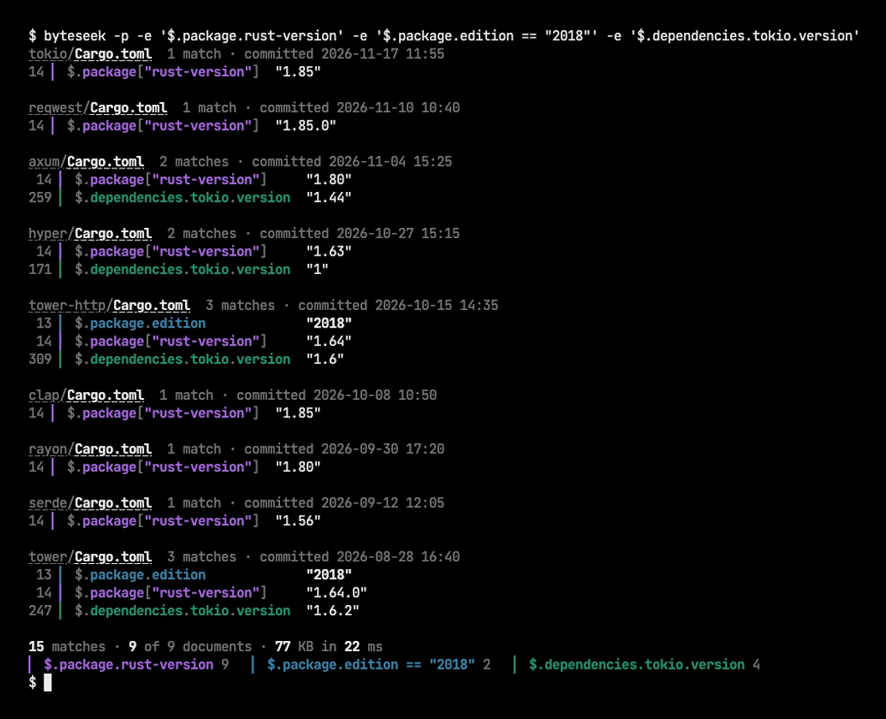
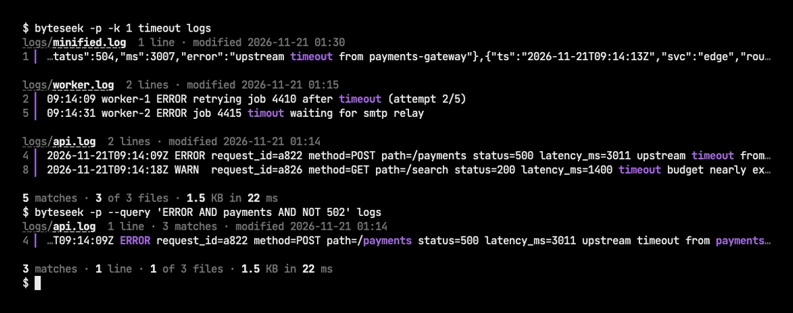
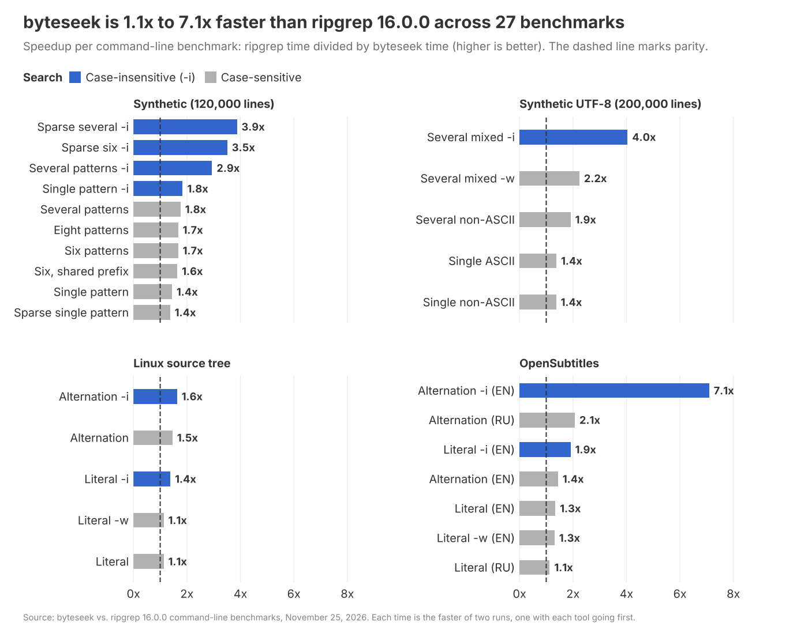

# byteseek

> [!WARNING]
> This project is being open-sourced earlier than typical in order to transparently demonstrate the power of Opus 5.5/Fable 5.2 in creating software which is faster than state-of-the-art implementations. It has not been fully tested on robust real-world data...yet.

byteseek is modern reimplementation of `grep` for logs, code, and structured data, with a command-line tool that is a drop-in replacement for most of [ripgrep](https://github.com/BurntSushi/ripgrep) at faster speeds with a few more fancy tools.



`byteseek` can also parse JSON, YAML, and TOML files and search them by [jq](https://jqlang.org)-style path, by value, or with predicates such as `$.payload.latency_ms > 1000`.



For humans, byteseek has `-p/--pretty` output options which provide more semantic context and accessible coloring to the output, making it much easier to process at-a-glance.





More useful features of `byteseek`:

- **Fuzzy matching** with `-k/--max-errors`, which finds text within N typos (insertions, deletions, or substitutions) of a pattern. For example, searching for `timeout` at `-k 1` also catches `timout`.
- **Boolean queries** with `--query`, which select lines that contain every required term in any order such as `'ERROR AND payments AND NOT retrying'`.
- **Python bindings** with full type hints that release the GIL while searching which allows searches from multiple threads run in parallel. See the [Jupyter Notebook](notebooks/byteseek_demo.ipynb) for more demos.
- **Strong performance** at a low memory footprint: on ripgrep's own benchmark corpora, the `byteseek` CLI is 1.1x to 7.5x faster than `rg` end to end with about half of its peak memory, and the Python bindings significantly surpassing optimized packages in this domain such as [pyahocorasick](https://github.com/WojciechMula/pyahocorasick) and [orjson](https://github.com/ijl/orjson). ([Benchmarks](#performance))

## Installation

The CLI installs [from crates.io](https://crates.io/crates/byteseek) with Cargo (Rust 1.96+):

```sh
cargo install byteseek
```

In Python, [from PyPI](https://pypi.org/project/byteseek/):

```sh
pip3 install byteseek
```

```sh
uv pip install byteseek
```

The Python package also installs the full `byteseek` command line, compiled into the package itself, so `byteseek` (or `python -m byteseek`) works without Cargo and takes the same flags as the native binary.

## Usage

Run `byteseek` with a pattern to search every file under the current directory, skipping hidden files, binary files, and anything matched by a `.gitignore`. Any `ripgrep` command that uses literal patterns works unchanged, including `-e` for multiple patterns, `-i/-S` for case, `-w/-x` for whole words and lines, `-A/-B/-C` for context, `-c/-l/-o` for counts, files, and matches, `-g/-t` for globs and file types, and `--column/-0` for editors and `xargs`. `--sort recent` orders plain output by the file's last Git commit/last modified and `--sort path` orders it by path, as in `rg`.

```sh
byteseek -e Claude src
```

```sh
byteseek -i -e Claude -e GPT src
```

The output is similar to `ripgrep/rg`'s.

## Structured Search

A pattern starting with `$.` or `$[` parses each file as a document in the format its extension names: `.json`, `.jsonl`, or `.ndjson` for JSON, `.yaml` or `.yml` for YAML, and `.toml` for TOML. `--parse json`, `--parse yaml`, or `--parse toml` picks the format instead, such as for a file with another extension or for stdin.


Every pattern then matches one of three ways:

- Plain text matches inside scalar values, such as `failed`.
- A pattern starting with `$` matches a path exactly, such as `$.replicas`, or a path with the value written after an `=` without spaces, such as `$.service=payments`.
- A predicate compares values with `==` (or `=` with spaces around it), `!=`, `>`, `>=`, `<`, `<=`, or `BETWEEN 100 AND 1000`, and clauses join with `AND`. A predicate's path matches at any depth and its clauses must hold within the same object, so `$.payload.latency_ms > 1000` checks every event's `payload`.

Predicates compare numbers, strings, booleans, and RFC 3339 timestamps, and skip values that are null or of another type; `--strict` makes those an error instead. A quoted literal is always a string or a timestamp, so `== "2018"` matches the string `"2018"` and not the number `2018`.

JSON Lines are searched like `jq` reads them: each value is its own document whose paths start at `$` so a log with one event per line can be filtered with `'$.level == "error" AND $.latency_ms > 1000'`.

## Pretty Output

`-p/--pretty` is opt-in as its layout differs from `ripgrep`'s and it is optimized for better human readbility. JSON/YAML/TOML syntax highlighting will be displayed for those searches.

#### JSON



#### YAML



#### TOML



## Fuzzy and Boolean Predicate Search

`-k N` also matches text within N edits of each pattern which catches typos and OCR errors that an exact search misses. `--query` treats each pattern as a boolean query over the terms in a line, in any order, and highlights the terms that made the line match:



## Searcher APIs

### Python

A `Searcher` compiles its patterns once and searches strings, files, or whole directories. Match offsets are UTF-8 byte offsets, and `pattern_index` says which pattern matched.

```py3
from pathlib import Path

from byteseek import CaseMode, SearchConfig, Searcher

searcher = Searcher(["error", "timeout"], SearchConfig(case_mode=CaseMode.ASCII_INSENSITIVE))

text = Path("logs/worker.log").read_text()
for line in searcher.find_lines(text):
    print(line.line_number, line.line)

searcher.count(text)  # 3
searcher.contains("all good")  # False

for result in searcher.find_path("src"):
    print(result.path, len(result.matches))
```

`SearchConfig` also takes options such as `whole_word`, `max_matches`, `max_edit_distance` for fuzzy matching, and `boolean_queries`. Enum options also accept their string values, such as `structured_mode="json"`. For structured search, set `structured_mode`:

```py3
from byteseek import StructuredMode

events = Searcher(
    ["failed", "$.payload.latency_ms > 1000"],
    SearchConfig(structured_mode=StructuredMode.JSON),
)
for result in events.find_structured_path("data"):
    for match in result.matches:
        print(match.path, match.node_text)
```

```
$.events[1].payload.latency_ms 3011
$.events[1].payload.status "failed"
$.events[4].payload.latency_ms 2200
$.events[4].payload.status "failed"
```

View the [Jupyter Notebook](notebooks/byteseek_demo.ipynb) for more examples.

### Rust

The same `Searcher` is available as a Rust library. Turning off the default `cli` feature leaves out the command-line tool's dependencies:

```toml
[dependencies]
byteseek = { version = "0.1", default-features = false }
```

```rust
use byteseek::{CaseMode, SearchConfig, Searcher};

let config = SearchConfig::builder()
    .case_mode(CaseMode::AsciiInsensitive)
    .build();
let searcher = Searcher::new(["error", "timeout"], config)?;

for line in searcher.find_lines(&text) {
    println!("{}: {}", line.line_number, line.line);
}

let report = searcher.report_path("logs")?;
println!("{}", report.render_top_files_table(10));
```

## Performance

These results are for ripgrep's own [benchsuite](https://github.com/BurntSushi/ripgrep/tree/master/benchsuite) searches on its English subtitles corpus, comparing the `byteseek` and `rg` (16.0.0) command-line tools end to end on an Apple M3 Pro: each run starts a process, reads the file, and writes a count of matching lines.



See [BENCHMARKS.md](BENCHMARKS.md) for absolute timings and Python comparisons.

## AI Disclosure

`byteseek` was mostly made using Claude Opus 5.5 and Fable 5.2 with quality checks and balances as an experiment into how far an agent can push a search engine's performance against `ripgrep`, one of the most heavily optimized command-line tools there is.

For any Issues and Pull Requests that are submitted to this repo (particularly by agents), please manually review the output and ensure any suggestions and changes are high signal and precisely scoped: both a) low-effort PRs that cause more problems than they solve and b) nontechnical discussions about the use of agentic development may be closed without comment.

## Miscellaneous Notes

- The terminal screenshots were made using [vhs](https://github.com/charmbracelet/vhs) with an additional postprocessing step that crops each screenshot to only its text. The tapes are available in the [demo folder](/demo).

## To Be Added

- More tests with real-world data
- More feature parity with ripgrep (still deciding on which important features are NYI)
- May need to revaluate faded coloring semantics for `pretty` output depending on what information is most useful at a glance for humans

## Maintainer/Creator

Max Woolf ([@minimaxir](https://minimaxir.com))

_Max's open-source projects are supported by his [Patreon](https://www.patreon.com/minimaxir) and [GitHub Sponsors](https://github.com/sponsors/minimaxir). If you found this project helpful, any monetary contributions to the Patreon are appreciated and will be put to good creative use._

## License

MIT

The MIT LICENSE for ripgrep is also included as its base design and benchmarking suite were used for calibration: no library code from ripgrep is intentionally implemented.
